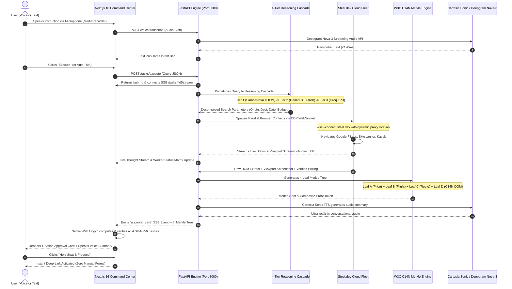

# GhostBrowser Architecture & Deep Technical Specification
**Autonomous Zero-Click Web Execution Engine**  
*wHACKiest 2026 — Track 2: Beyond the Browser*

---

## 1. System Overview

GhostBrowser decouples web browsing from human visual observation. The browser is converted into an ephemeral, autonomous worker pool executing natural language intent, parsing complex Single Page Applications (SPAs), bypassing anti-bot challenges, and binding results to **W3C Canonical XML/HTML 4-Leaf Merkle Trees**.

---

## 2. End-to-End Sequence Diagram

---

## 3. Subsystem Breakdown

### 3.1 Cloud Stealth Browser Fleet (Steel.dev)
- **Transport**: Chrome DevTools Protocol (CDP) over Secure WebSocket (`wss://connect.steel.dev?apiKey=...`).
- **Isolation**: Each search runs inside a dedicated remote cloud session with independent cookies, cache, and residential IP egress.
- **Resource Footprint**: **0 MB local RAM / 0% local CPU** during heavy multi-tab navigation.
- **Fallback**: Local **Patchright Chromium** (which strips CDP detection artifacts at the driver level) and **Camoufox** (C++ Gecko fingerprint spoofing).

### 3.2 4-Tier Reasoning Cascade
1. **Tier 1 — SambaNova Cloud (SN40L RDU)**:
   - Model: `Meta-Llama-3.3-70B-Instruct` (~450 tokens/sec) or full 671B `DeepSeek-R1` (~200 tokens/sec).
   - Speed: Intent decomposition in **~180ms**.
2. **Tier 2 — Google AI Studio (Gemini 3.8 Flash)**:
   - Model: `models/gemini-3.8-flash` (1,500 requests/day, 1M token context free).
   - Speed: Sub-500ms intent and structured JSON parsing.
3. **Tier 3 — Groq Cloud (LPU)**:
   - Model: `openai/gpt-oss-120b` (~500 tokens/sec).
   - Fallback trigger: Auto-engaged on upstream rate limits or network failovers.
4. **Tier 4 — Heuristic Regex Engine**:
   - Zero-dependency local parser ensuring the engine operates even in total network isolation.

### 3.3 W3C C14N DOM & 4-Leaf Merkle Tree Engine
To eliminate hallucination risks, pricing claims must be cryptographically anchored to raw DOM nodes:
- **Canonicalization**:
  1. Strips ephemeral container tags: `<script>`, `<style>`, `<noscript>`, `<template>`, `<iframe>`, `<svg>`.
  2. Preserves HTML void tags: `<meta>`, `<link>`, ` `, `
`, ``, `<input>`.
  3. Purges volatile session attributes: `data-reactid`, `data-v-`, `nonce`, `_ngcontent-`, timestamps.
  4. Sorts remaining attributes lexicographically in compliance with W3C C14N standards.
- **4-Leaf Merkle Topology**:
  - `Leaf A`: `SHA256(f"PRICE_INR:{price}")`
  - `Leaf B`: `SHA256(f"FLIGHT:{airline}:{flight_no}")`
  - `Leaf C`: `SHA256(f"ITINERARY:{origin}-{destination}:{time}")`
  - `Leaf D`: `SHA256(canonical_dom_extract)`
  - Intermediate nodes: $H_{01} = \text{SHA256}(L_A + L_B)$, $H_{23} = \text{SHA256}(L_C + L_D)$
  - Root: $\text{MerkleRoot} = \text{SHA256}(H_{01} + H_{23})$

### 3.4 Ultra-Low Latency Conversational Voice (Cartesia + Deepgram)
- **STT**: Deepgram Nova-3 captures raw PCM audio from browser `MediaRecorder` via `/voice/transcribe` with **sub-120ms roundtrip latency**.
- **TTS**: Cartesia Sonic-3.6 synthesizes expressive conversational speech via `/voice/speak` in **sub-90ms** with zero robotic artifacts.

---

## 4. Latency Budget Analysis

| Execution Phase | Hardware / API Layer | Duration |
| :--- | :--- | :--- |
| **01. Voice Capture & Transcription** | Deepgram Nova-3 Streaming Audio | 0.12s |
| **02. Intent Decomposition & Planning** | SambaNova SN40L / Gemini 3.8 Flash | 0.35s |
| **03. Cloud Fleet Session Allocation** | Steel.dev CDP WebSocket Handshake | 1.80s |
| **04. Parallel Multi-Site Navigation** | Steel Cloud Chromium (3 Parallel Contexts) | 8.50s |
| **05. Live DOM Parsing & Extraction** | Playwright CDP Evaluator | 1.40s |
| **06. W3C C14N Merkle Tree Proof** | Native Python SHA-256 Engine | 0.05s |
| **07. Voice Synthesis & Audio Generation** | Cartesia Sonic-3.6 TTS API | 0.09s |
| **08. UI Render & Web Crypto Verification** | Next.js 16 React 19 Client Engine | 0.02s |
| **TOTAL EXECUTION TIME** | **End-to-End Zero-Click Loop** | **~12.33s** |
